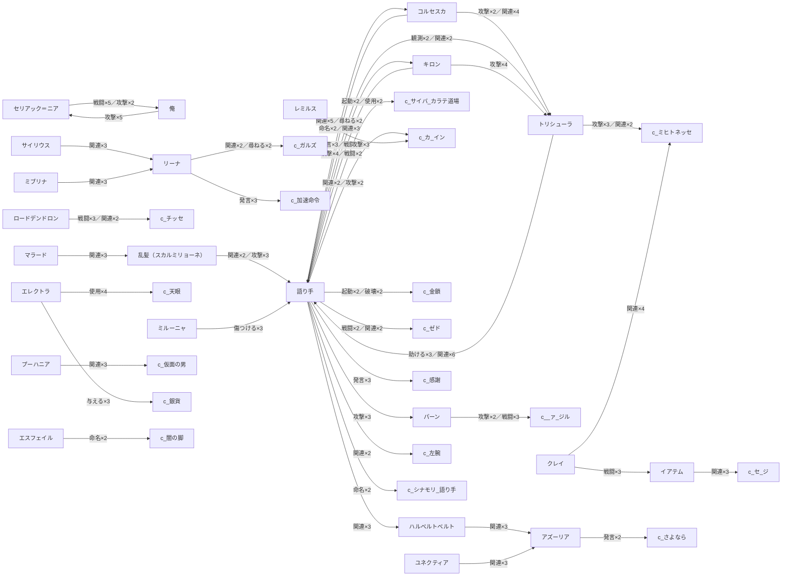

# 関係性マップ

イベント観測（3265 三つ組）から、相互に 2 回以上観測されたキャラ間関係を上位 40 件。各キャラページに「関係キャラクター」を注入したため、右サイドの **グラフ** も関係性マップになります（ノードがキャラ、辺が観測された関係）。

## 関係グラフ（観測上位）

> 矢印は観測の方向（主語→目的語）。ラベルは関係の種別×観測回数。

## 上位の関係（観測順）

- [[E_char_アキラ|語り手]] → [[E_char_キロン|キロン]] — 発言(3)／戦闘(2)／関連(3)、計 17 観測
- [[E_char_トリシューラ|トリシューラ]] → [[E_char_アキラ|語り手]] — 助ける(3)／関連(6)／欺く(2)、計 16 観測
- [[E_char_コルセスカ|コルセスカ]] → [[E_char_トリシューラ|トリシューラ]] — 攻撃(2)／関連(4)／戦闘(2)、計 8 観測
- [[E_char_アキラ|語り手]] → [[E_char_トリシューラ|トリシューラ]] — 観測(2)／関連(2)／尋ねる(4)、計 8 観測
- [[E_char_コルセスカ|コルセスカ]] → [[E_char_アキラ|語り手]] — 命名(2)／関連(3)／助ける(2)、計 7 観測
- [[E_char_アキラ|語り手]] → [[E_char_コルセスカ|コルセスカ]] — 関連(5)／尋ねる(2)、計 7 観測
- [[E_char_セリアック＝ニア|セリアック＝ニア]] → [[E_char_シナモリアキラ|俺]] — 戦闘(5)／攻撃(2)、計 7 観測
- [[E_char_キロン|キロン]] → [[E_char_アキラ|語り手]] — 攻撃(4)／戦闘(2)、計 6 観測
- [[E_char_ルバーブ|乱髪（スカルミリョーネ）]] → [[E_char_アキラ|語り手]] — 関連(2)／攻撃(3)、計 5 観測
- [[E_char_トリシューラ|トリシューラ]] → [[E_char_ミヒトネッセ|ミヒトネッセ]] — 攻撃(3)／関連(2)、計 5 観測
- [[E_char_パーン|パーン]] → [[E_char_ヴァージル|ヴァージル]] — 攻撃(2)／戦闘(3)、計 5 観測
- [[E_char_シナモリアキラ|俺]] → [[E_char_セリアック＝ニア|セリアック＝ニア]] — 攻撃(5)、計 5 観測
- [[E_char_ロードデンドロン|ロードデンドロン]] → [[E_char_チッセ|チッセ]] — 戦闘(3)／関連(2)、計 5 観測
- [[E_char_アキラ|語り手]] → [[E_char_サイバーカラテ道場|サイバーカラテ道場]] — 起動(2)／使用(2)、計 4 観測
- [[E_char_アキラ|語り手]] → [[E_char_カーイン|カーイン]] — 関連(2)／攻撃(2)、計 4 観測
- [[E_char_キロン|キロン]] → [[E_char_トリシューラ|トリシューラ]] — 攻撃(4)、計 4 観測
- [[E_char_アキラ|語り手]] → [[E_char_金鎖|金鎖]] — 起動(2)／破壊(2)、計 4 観測
- [[E_char_リーナ|リーナ]] → [[E_char_ガルズ|ガルズ]] — 関連(2)／尋ねる(2)、計 4 観測
- [[E_char_アキラ|語り手]] → [[E_char_ゼド|ゼド]] — 戦闘(2)／関連(2)、計 4 観測
- [[E_char_クレイ|クレイ]] → [[E_char_ミヒトネッセ|ミヒトネッセ]] — 関連(4)、計 4 観測
- [[E_char_ユディーア|エレクトラ]] → [[E_char_天眼|天眼]] — 使用(4)、計 4 観測
- [[E_char_ハルベルト|ハルベルトベルト]] → [[E_char_アズーリア|アズーリア]] — 関連(3)、計 3 観測
- [[E_char_アキラ|語り手]] → [[E_char_ハルベルト|ハルベルトベルト]] — 関連(3)、計 3 観測
- [[E_char_ミルーニャ|ミルーニャ]] → [[E_char_アキラ|語り手]] — 傷つける(3)、計 3 観測
- [[E_char_アキラ|語り手]] → [[E_char_感謝|感謝]] — 発言(3)、計 3 観測
- [[E_char_サイリウス|サイリウス]] → [[E_char_リーナ|リーナ]] — 関連(3)、計 3 観測
- [[E_char_ユネクティア|ユネクティア]] → [[E_char_アズーリア|アズーリア]] — 関連(3)、計 3 観測
- [[E_char_リーナ|リーナ]] → [[E_char_加速命令|加速命令]] — 発言(3)、計 3 観測
- [[E_char_イアテム|イアテム]] → [[E_char_セージ|セージ]] — 関連(3)、計 3 観測
- [[E_char_マラード|マラード]] → [[E_char_ルバーブ|乱髪（スカルミリョーネ）]] — 関連(3)、計 3 観測
- [[E_char_アキラ|語り手]] → [[E_char_パーン|パーン]] — 攻撃(3)、計 3 観測
- [[E_char_クレイ|クレイ]] → [[E_char_イアテム|イアテム]] — 戦闘(3)、計 3 観測
- [[E_char_プーハニア|プーハニア]] → [[E_char_仮面の男|仮面の男]] — 関連(3)、計 3 観測
- [[E_char_レミルス|レミルス]] → [[E_char_カーイン|カーイン]] — 攻撃(3)、計 3 観測
- [[E_char_ユディーア|エレクトラ]] → [[E_char_銀貨|銀貨]] — 与える(3)、計 3 観測
- [[E_char_ミブリナ|ミブリナ]] → [[E_char_リーナ|リーナ]] — 関連(3)、計 3 観測
- [[E_char_アキラ|語り手]] → [[E_char_左腕|左腕]] — 関連(2)、計 2 観測
- [[E_char_アキラ|語り手]] → [[E_char_シナモリ・アキラ|シナモリアキラ]] — 命名(2)、計 2 観測
- [[E_char_エスフェイル|エスフェイル]] → [[E_char_闇の脚|闇の脚]] — 命名(2)、計 2 観測
- [[E_char_アズーリア|アズーリア]] → [[E_char_さよなら|さよなら]] — 発言(2)、計 2 観測

---

## 名前正規化監査（L2 run 20261113T1230_v10）

| 元名義 | 代表名 | 確度 | 置換件数 |
|---|---|---|---|
| アキラ | 語り手 | 明言 | 47 |
| シナモリアキラ | 俺 | 明言 | 5 |
| ハル | ハルベルト | 明言 | 5 |
| ユディーア | エレクトラ | 明言 | 4 |
| ルバーブ | 乱髪（スカルミリョーネ） | 明言 | 3 |
| シナモリ・アキラ | シナモリアキラ | 明言 | 1 |

注記（置換しない）:
- 未置換（要検証）: 「アズ」→ アズーリア（要検証）
- 未置換（要検証）: 「ヴァージル」→ レオ（要検証）
- 未置換（要検証）: 「アズーリア」→ アズーリア(報告書)（要検証）
- 未置換（要検証）: 「コルセスカ」→ コルセスカ(アキラ経由)（要検証）
- 未置換（要検証）: 「セリアック＝ニア」→ セリアック=ニア(分裂体)（要検証）
- 未置換（要検証）: 「トリシューラ」→ トリシューラ(別個体)（要検証）
- 未置換（要検証）: 「ハルベルト」→ ハルベルト(幼少期)（要検証）