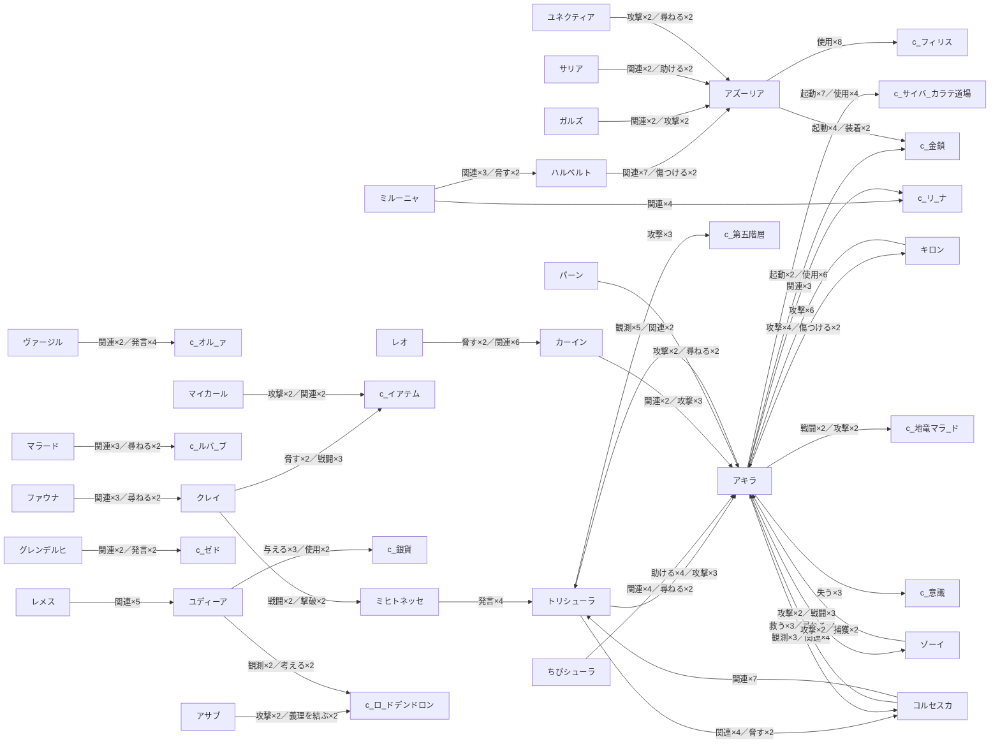

# 関係性マップ

イベント観測（4663 三つ組）から、相互に 2 回以上観測されたキャラ間関係を上位 40 件。各キャラページに「関係キャラクター」を注入したため、右サイドの **グラフ** も関係性マップになります（ノードがキャラ、辺が観測された関係）。

## 関係グラフ（観測上位）

> 矢印は観測の方向（主語→目的語）。ラベルは関係の種別×観測回数。

## 上位の関係（観測順）

- [[E_char_トリシューラ|トリシューラ]] → [[E_char_アキラ|アキラ]] — 助ける(4)／攻撃(3)／関連(12)、計 28 観測
- [[E_char_コルセスカ|コルセスカ]] → [[E_char_アキラ|アキラ]] — 救う(3)／尋ねる(4)／関連(13)、計 26 観測
- [[E_char_トリシューラ|トリシューラ]] → [[E_char_コルセスカ|コルセスカ]] — 関連(4)／脅す(2)／攻撃(4)、計 16 観測
- [[E_char_アキラ|アキラ]] → [[E_char_トリシューラ|トリシューラ]] — 観測(5)／関連(2)／義理を結ぶ(2)、計 12 観測
- [[E_char_アキラ|アキラ]] → [[E_char_サイバーカラテ道場|サイバーカラテ道場]] — 起動(7)／使用(4)、計 11 観測
- [[E_char_アキラ|アキラ]] → [[E_char_キロン|キロン]] — 攻撃(4)／傷つける(2)／戦闘(4)、計 10 観測
- [[E_char_アキラ|アキラ]] → [[E_char_コルセスカ|コルセスカ]] — 観測(3)／関連(4)／考える(2)、計 9 観測
- [[E_char_ハルベルト|ハルベルト]] → [[E_char_アズーリア|アズーリア]] — 関連(7)／傷つける(2)、計 9 観測
- [[E_char_ちびシューラ|ちびシューラ]] → [[E_char_アキラ|アキラ]] — 関連(4)／尋ねる(2)／発言(2)、計 8 観測
- [[E_char_アキラ|アキラ]] → [[E_char_金鎖|金鎖]] — 起動(2)／使用(6)、計 8 観測
- [[E_char_アズーリア|アズーリア]] → [[E_char_フィリス|フィリス]] — 使用(8)、計 8 観測
- [[E_char_レオ|レオ]] → [[E_char_カーイン|カーイン]] — 脅す(2)／関連(6)、計 8 観測
- [[E_char_アキラ|アキラ]] → [[E_char_ゾーイ|ゾーイ]] — 攻撃(2)／戦闘(3)／撃破(3)、計 8 観測
- [[E_char_ヴァージル|ヴァージル]] → [[E_char_オルヴァ|オルヴァ]] — 関連(2)／発言(4)／攻撃(2)、計 8 観測
- [[E_char_コルセスカ|コルセスカ]] → [[E_char_トリシューラ|トリシューラ]] — 関連(7)、計 7 観測
- [[E_char_キロン|キロン]] → [[E_char_アキラ|アキラ]] — 攻撃(6)、計 6 観測
- [[E_char_アズーリア|アズーリア]] → [[E_char_金鎖|金鎖]] — 起動(4)／装着(2)、計 6 観測
- [[E_char_ゾーイ|ゾーイ]] → [[E_char_アキラ|アキラ]] — 攻撃(2)／捕獲(2)／戦闘(2)、計 6 観測
- [[E_char_カーイン|カーイン]] → [[E_char_アキラ|アキラ]] — 関連(2)／攻撃(3)、計 5 観測
- [[E_char_ミルーニャ|ミルーニャ]] → [[E_char_ハルベルト|ハルベルト]] — 関連(3)／脅す(2)、計 5 観測
- [[E_char_クレイ|クレイ]] → [[E_char_イアテム|イアテム]] — 脅す(2)／戦闘(3)、計 5 観測
- [[E_char_マラード|マラード]] → [[E_char_ルバーブ|ルバーブ]] — 関連(3)／尋ねる(2)、計 5 観測
- [[E_char_ファウナ|ファウナ]] → [[E_char_クレイ|クレイ]] — 関連(3)／尋ねる(2)、計 5 観測
- [[E_char_ユディーア|ユディーア]] → [[E_char_銀貨|銀貨]] — 与える(3)／使用(2)、計 5 観測
- [[E_char_レメス|レメス]] → [[E_char_ユディーア|ユディーア]] — 関連(5)、計 5 観測
- [[E_char_ミルーニャ|ミルーニャ]] → [[E_char_リーナ|リーナ]] — 関連(4)、計 4 観測
- [[E_char_ガルズ|ガルズ]] → [[E_char_アズーリア|アズーリア]] — 関連(2)／攻撃(2)、計 4 観測
- [[E_char_サリア|サリア]] → [[E_char_アズーリア|アズーリア]] — 関連(2)／助ける(2)、計 4 観測
- [[E_char_ユネクティア|ユネクティア]] → [[E_char_アズーリア|アズーリア]] — 攻撃(2)／尋ねる(2)、計 4 観測
- [[E_char_グレンデルヒ|グレンデルヒ]] → [[E_char_ゼド|ゼド]] — 関連(2)／発言(2)、計 4 観測
- [[E_char_パーン|パーン]] → [[E_char_アキラ|アキラ]] — 攻撃(2)／尋ねる(2)、計 4 観測
- [[E_char_ミヒトネッセ|ミヒトネッセ]] → [[E_char_トリシューラ|トリシューラ]] — 発言(4)、計 4 観測
- [[E_char_アキラ|アキラ]] → [[E_char_地竜マラード|地竜マラード]] — 戦闘(2)／攻撃(2)、計 4 観測
- [[E_char_マイカール|マイカール]] → [[E_char_イアテム|イアテム]] — 攻撃(2)／関連(2)、計 4 観測
- [[E_char_クレイ|クレイ]] → [[E_char_ミヒトネッセ|ミヒトネッセ]] — 戦闘(2)／撃破(2)、計 4 観測
- [[E_char_アサブ|アサブ]] → [[E_char_ロードデンドロン|ロードデンドロン]] — 攻撃(2)／義理を結ぶ(2)、計 4 観測
- [[E_char_ユディーア|ユディーア]] → [[E_char_ロードデンドロン|ロードデンドロン]] — 観測(2)／考える(2)、計 4 観測
- [[E_char_アキラ|アキラ]] → [[E_char_意識|意識]] — 失う(3)、計 3 観測
- [[E_char_トリシューラ|トリシューラ]] → [[E_char_第五階層|第五階層]] — 攻撃(3)、計 3 観測
- [[E_char_アキラ|アキラ]] → [[E_char_リーナ|リーナ]] — 関連(3)、計 3 観測
